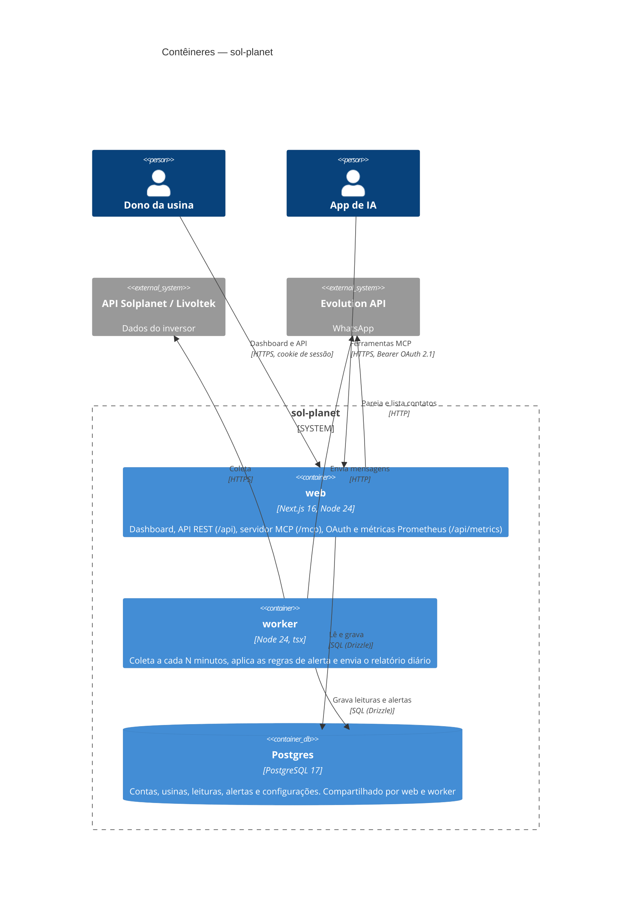

# C4 — Nível 2: Contêineres

O que roda dentro do sol-planet. Cada caixa é um processo ou serviço que sobe no Docker Compose.

## Como isso aparece no repositório

| Contêiner | Código | Imagem (`Dockerfile`) |
|---|---|---|
| web | [apps/web](../../apps/web) | alvo `web` |
| worker | [apps/worker](../../apps/worker) | alvo `worker` |
| Postgres | [packages/db](../../packages/db) (schema Drizzle e migrações) | `postgres:17-alpine` no [compose local](../../docker-compose.local.yml); em produção, o Postgres que já existe na VPS |

Bibliotecas compartilhadas, dentro de `packages/`: `solplanet`, `livoltek`, `whatsapp` (clientes de API) e `observability` (logs pino e métrica).

## Por ambiente

- **Avaliação/local** ([docker-compose.local.yml](../../docker-compose.local.yml)): Postgres, um contêiner `seed` que popula dados simulados, e o `web`. O `worker` só sobe com `--profile coleta`.
- **Produção** ([docker-compose.yml](../../docker-compose.yml)): `web` e `worker` ligados por rede externa ao Postgres da VPS. A Evolution API é opcional (`--profile evolution`).
