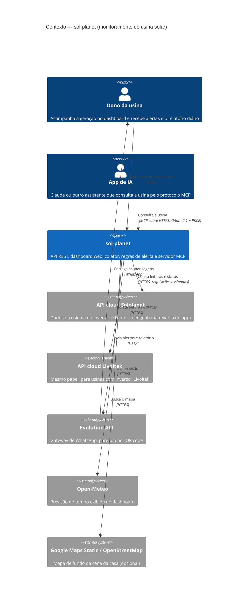

# C4 — Nível 1: Contexto do sistema

Quem usa o sol-planet e com quais sistemas externos ele conversa. Os diagramas são Mermaid e o GitHub os renderiza direto.

## Notas

- O login do dashboard é a própria conta Solplanet ou Livoltek do usuário: o sol-planet confere as credenciais na API do fornecedor e guarda a senha cifrada (AES-256-GCM).
- O sistema só **lê** dados da usina. Os comandos de controle remoto do app foram deixados de fora de propósito.
- Open-Meteo e mapa são acessórios: se falharem, o dashboard segue funcionando sem eles.
