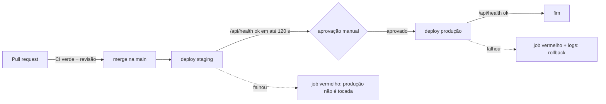

# Ambientes e estratégia de deploy

## Ambientes

| | Staging | Produção |
|---|---|---|
| Para que serve | Homologar cada mudança e permitir a avaliação | Monitorar a usina real |
| Dados | **Simulados** (seed: usina demo, 400 dias de histórico e alertas) | Reais |
| Compose | [docker-compose.staging.yml](../docker-compose.staging.yml) | [docker-compose.yml](../docker-compose.yml) |
| Pasta na VPS / projeto compose | `~/solar-staging` / `solar-staging` | `~/solar` / `solar` |
| Banco | Postgres próprio, volume `pg_staging`, recriado a cada deploy | Postgres existente da VPS (rede `PG_NETWORK`) |
| Porta (`WEB_PORT`) | 3011 | do `.env` (padrão 3000) |
| Worker de coleta e WhatsApp | Não sobe | Sobe |
| Aprovação | Automática | Manual (GitHub Environment `production`) |
| `.env` | Criado sozinho no 1º deploy, com `AUTH_SECRET` aleatório | Criado à mão a partir do [.env.example](../.env.example) |

Configuração diferente por ambiente vem **só de variáveis de ambiente**: o código é o mesmo nos dois. Segredos ficam no `.env` da VPS e nos *secrets* do GitHub, nunca no repositório. O [.env.example](../.env.example) é validado contra o código a cada CI (`pnpm lint:env`).

## Fluxo



1. Todo código chega à `main` por pull request, com os checks `qualidade` e `segredos` verdes (ver [proteção da branch](#proteção-da-branch)).
2. O push na `main` dispara [deploy.yml](../.github/workflows/deploy.yml). Mudanças só em `.md` não implantam nada.
3. O **staging** é implantado primeiro. O deploy só vale se `GET /api/health` responder em até 120 s.
4. A **produção** espera aprovação no GitHub Environment `production` e repete a mesma verificação de saúde.

## Estratégia de implantação: recriação simples com verificação, sem *blue-green*

O `docker compose up -d --build` reconstrói a imagem e recria os contêineres que mudaram. Há alguns segundos de indisponibilidade do dashboard durante a troca, e isso é aceito: é um monitor de uso pessoal, o worker retoma a coleta sozinho no ciclo seguinte e nenhum dado se perde (as leituras ficam no Postgres, que não é recriado).

Por que não *blue-green* ou *canary*: exigiriam duas cópias rodando e um proxy que alterne o tráfego, e o ganho não compensa para este tamanho. A proteção real contra um deploy ruim é o conjunto *staging primeiro + aprovação manual + verificação de saúde*, mais o rollback abaixo.

## Rollback

Reimplante um commit anterior. Em **Actions → Deploy Solar → Run workflow**, informe em `ref` o SHA (ou tag) da versão boa. O fluxo roda igual (staging, aprovação, produção) com o código antigo. O banco **não** é revertido: antes de voltar a um commit antigo, confira se a migração do commit descartado continua compatível com o código antigo.

## Feature flag

`FEATURE_MCP` liga e desliga o servidor MCP, o OAuth e a página "Conectar IA" (padrão: ligada). A flag é uma variável de ambiente lida em tempo de execução, então não exige novo build:

```bash
# na VPS, no .env do ambiente
FEATURE_MCP=off
docker compose -p solar up -d web     # recria só o web com o novo valor
```

Com ela desligada, `/mcp`, `/oauth/*`, `/.well-known/oauth-*` e `/conectar-ia` respondem 404 e o item "IA" some do menu. Use o staging para conferir o efeito antes de aplicar em produção. A escolha por variável de ambiente, e não por uma plataforma de flags, está no [ADR 0002](adr/0002-flags-por-ambiente-e-staging-na-vps.md).

## Proteção da branch

A `main` é protegida: sem push direto, só pull request com os checks da CI verdes, sem *force push* e sem exclusão. Como o deploy dispara em push na `main`, isso garante que **só código revisado e testado chega ao staging e à produção**.

## Configuração única no GitHub e na VPS

1. **Environments** (Settings → Environments): criar `staging` (sem regras) e `production` (*Required reviewers*: o próprio dono). Os *secrets* `VPS_HOST`, `VPS_PORT`, `VPS_USER` e `VPS_SSH_KEY` já existem no repositório e servem aos dois ambientes.
2. **Proxy reverso** (nginx/Caddy) do subdomínio de staging apontando para `127.0.0.1:3011`, com HTTPS. A VPS precisa de `docker compose` e `curl`.
