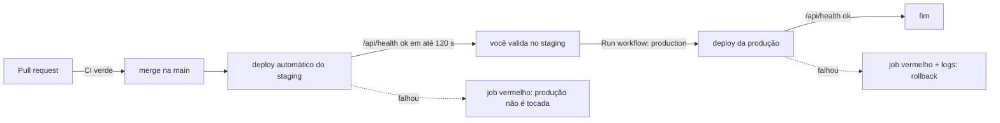

# Ambientes e estratégia de deploy

## Ambientes

| | Staging | Produção |
|---|---|---|
| Para que serve | Homologar cada mudança e permitir a avaliação | Monitorar a usina real |
| Dados | **Simulados** (seed: usina demo, 400 dias de histórico e alertas) | Reais |
| Compose | [docker-compose.staging.yml](../docker-compose.staging.yml) | [docker-compose.yml](../docker-compose.yml) |
| Pasta na VPS / projeto compose | `~/solar-staging` / `solar-staging` | `~/solar` / `solar` |
| Banco | Postgres próprio, volume `pg_staging`, recriado a cada deploy | Postgres existente da VPS (rede `PG_NETWORK`) |
| Endereço no proxy reverso | `http://solar-staging-web:3000` | `http://solar-web:3000` |
| Porta no host (`WEB_PORT`) | 3011, só em `127.0.0.1`, usada pelo health do deploy | do `.env` (padrão 3000) |
| Worker de coleta e WhatsApp | Não sobe | Sobe |
| Como sobe | Automático a cada merge na `main` | **Só manual**: *Run workflow* escolhendo `production`, a partir da `main` |
| `.env` | Criado sozinho no 1º deploy, com `AUTH_SECRET` aleatório | Criado à mão a partir do [.env.example](../.env.example) |

Configuração diferente por ambiente vem **só de variáveis de ambiente**: o código é o mesmo nos dois. Segredos ficam no `.env` da VPS e nos *secrets* do GitHub, nunca no repositório. O [.env.example](../.env.example) é validado contra o código a cada CI (`pnpm lint:env`).

## Fluxo



1. Todo código chega à `main` por pull request, com os checks da CI verdes (ver [proteção da branch](#proteção-da-branch)).
2. O push na `main` dispara [deploy.yml](../.github/workflows/deploy.yml) e implanta o **staging**. Mudanças só em `.md` não implantam nada. O deploy só vale se `GET /api/health` responder em até 120 s.
3. Depois de conferir o staging, a **produção** é liberada à mão: **Actions → Deploy Solar → Run workflow**, com *Use workflow from* = `main` e `ambiente` = `production`. O workflow recusa produção a partir de qualquer outra branch. Esse clique é a aprovação, e a verificação de saúde se repete.

O GitHub só oferece aprovador obrigatório em Environments para repositórios privados no plano pago. Por isso a aprovação é o acionamento manual, e não uma regra do Environment.

## Estratégia de implantação: recriação simples com verificação, sem *blue-green*

O `docker compose up -d --build` reconstrói a imagem e recria os contêineres que mudaram. Há alguns segundos de indisponibilidade do dashboard durante a troca, e isso é aceito: é um monitor de uso pessoal, o worker retoma a coleta sozinho no ciclo seguinte e nenhum dado se perde (as leituras ficam no Postgres, que não é recriado).

Por que não *blue-green* ou *canary*: exigiriam duas cópias rodando e um proxy que alterne o tráfego, e o ganho não compensa para este tamanho. A proteção real contra um deploy ruim é o conjunto *staging primeiro + liberação manual + verificação de saúde*, mais o rollback abaixo.

## Rollback

Reimplante um commit anterior. Em **Actions → Deploy Solar → Run workflow**, com `ambiente` = `production` e *Use workflow from* = `main`, informe em `ref` o SHA (ou tag) da versão boa. É o mesmo botão do deploy normal, apontando para o código antigo. O banco **não** é revertido: antes de voltar a um commit antigo, confira se a migração do commit descartado continua compatível com o código antigo.

## Feature flag

`FEATURE_MCP` liga e desliga o servidor MCP, o OAuth e a página "Conectar IA" (padrão: ligada). A flag é uma variável de ambiente lida em tempo de execução, então não exige novo build:

```bash
# na VPS, no .env do ambiente
FEATURE_MCP=off
docker compose -p solar up -d web     # recria só o web com o novo valor
```

Com ela desligada, `/mcp`, `/oauth/*`, `/.well-known/oauth-*` e `/conectar-ia` respondem 404 e o item "IA" some do menu. Use o staging para conferir o efeito antes de aplicar em produção. A escolha por variável de ambiente, e não por uma plataforma de flags, está no [ADR 0002](adr/0002-flags-por-ambiente-e-staging-na-vps.md).

## Proteção da branch

A `main` é protegida por um *ruleset* do GitHub, sem exceção para ninguém (nem para o dono): sem push direto, só pull request com o check `gates` verde (ele resume os jobs `lint`, `tipos`, `build`, `contratos`, `testes` e `segredos`, que rodam em paralelo), sem *force push* e sem exclusão. Como o deploy dispara em push na `main` e a produção só sobe a partir dela, **só código que passou pela CI chega aos ambientes**.

## Configuração única no GitHub e na VPS

1. **Environments** (Settings → Environments): criar `staging` e `production`, sem regras (aprovador obrigatório exige plano pago); `production` aceita deploy só da `main`. Os *secrets* `VPS_HOST`, `VPS_PORT`, `VPS_USER` e `VPS_SSH_KEY` já existem no repositório e servem aos dois ambientes.
2. **Rede do proxy.** O `solar-staging-web` precisa estar na mesma rede Docker do Nginx Proxy Manager (a mesma em que ele alcança o `solar-web`). O compose usa a rede externa `PROXY_NETWORK` (padrão `wp-network`). Confira o nome certo na VPS e, se for outro, defina `PROXY_NETWORK=<rede>` no `~/solar-staging/.env`:
   ```bash
   docker inspect solar-web --format '{{range $k,$v := .NetworkSettings.Networks}}{{$k}} {{end}}'
   ```
3. **DNS:** um registro do subdomínio de staging apontando para a VPS (ou um curinga já existente).
4. **Nginx Proxy Manager** → *Add Proxy Host*, igual ao da produção: *Domain Names* = o subdomínio de staging; *Scheme* `http`; *Forward Hostname* `solar-staging-web`; *Forward Port* `3000`; aba SSL com Let's Encrypt e *Force SSL*. Só o `web` entra na rede do proxy. O Postgres do staging fica isolado na rede do próprio compose.
5. A VPS precisa de `docker compose` e `curl`.
