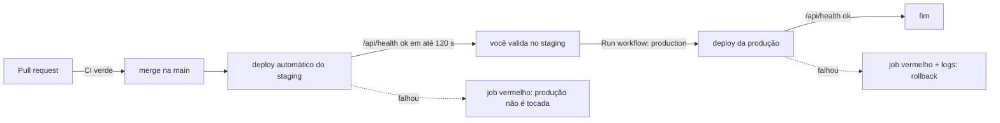

# Ambientes e estratégia de deploy

## Ambientes

| | Staging | Produção |
|---|---|---|
| Para que serve | Homologar cada mudança e permitir a avaliação | Monitorar a usina real |
| Dados | **Simulados** (seed: usina demo, 400 dias de histórico e alertas) | Reais |
| Compose | [docker-compose.staging.yml](../docker-compose.staging.yml) | [docker-compose.yml](../docker-compose.yml) |
| Pasta na VPS / projeto compose | `~/solar-staging` / `solar-staging` | `~/solar` / `solar` |
| Banco | Postgres próprio, volume `pg_staging`, recriado a cada deploy | Postgres existente da VPS (rede `PG_NETWORK`) |
| URL pública | https://staging-solar.rafiweb.com.br | https://solar.rafiweb.com.br |
| Endereço no proxy reverso | `http://solar-staging-web:3000` | `http://solar-web:3000` |
| Porta no host (`WEB_PORT`) | 3011, só em `127.0.0.1`, usada pelo health do deploy | do `.env` (padrão 3000) |
| Worker de coleta e WhatsApp | Não sobe | Sobe |
| Como sobe | Automático a cada merge na `main` | **Só manual**: *Run workflow* escolhendo `production`, a partir da `main` |
| `.env` | Criado sozinho no 1º deploy, com `AUTH_SECRET` aleatório | Criado à mão a partir do [.env.example](../.env.example) |

Configuração diferente por ambiente vem **só de variáveis de ambiente**: o código é o mesmo nos dois. Segredos ficam no `.env` da VPS e nos *secrets* do GitHub, nunca no repositório. O [.env.example](../.env.example) é validado contra o código a cada CI (`pnpm lint:env`).

## Fluxo



1. Todo código chega à `main` por pull request, com os checks da CI verdes (ver [proteção da branch](#proteção-da-branch)).
2. O push na `main` dispara [deploy.yml](../.github/workflows/deploy.yml) e implanta o **staging**. Mudanças só em `.md` não implantam nada. O deploy só vale se `GET /api/health` responder em até 120 s.
3. Depois de conferir o staging, a **produção** é liberada à mão: **Actions → Deploy Solar → Run workflow**, com *Use workflow from* = `main` e `ambiente` = `production`. O workflow recusa produção a partir de qualquer outra branch. Esse clique é a aprovação, e a verificação de saúde se repete.

O GitHub só oferece aprovador obrigatório em Environments para repositórios privados no plano pago. Por isso a aprovação é o acionamento manual, e não uma regra do Environment.

## Como testar o staging

URL: https://staging-solar.rafiweb.com.br. Os dados são simulados e a conta demo é `demo@solar.local` / `demo-sem-coleta` (entra pela tela de login).

### Swagger (o jeito mais simples)

1. Entre em `/login` com a conta demo.
2. Abra **`/docs`**: o Swagger UI lista as 11 rotas do contrato. O *Try it out* já vem ativado e chama o próprio staging, enviando o cookie do login. Experimente `GET /api/usinas/{id}/resumo` com `id` = `999001`.

O Swagger é a flag `FEATURE_DOCS`: **ligada no staging** pelo compose e **desligada por padrão** (na produção, `/docs` responde 404).

### Rotas e resultado esperado

| Rota | Login? | Esperado |
|---|---|---|
| `GET /api/health` | não | 200, `{"status":"ok","banco":"ok",...}` |
| `GET /api/metrics` | não | 200, formato Prometheus |
| `GET /.well-known/oauth-protected-resource` | não | 200, com `resource` terminando em `/mcp` |
| `POST /mcp` (sem token) | não | 401 |
| `GET /api/usinas/999001/resumo` | **sim** | 200, usina "Minha Casa" |
| `GET /api/alertas?tipo=offline&limite=5` | **sim** | 200, lista de alertas |
| `GET /api/usinas/999999999/resumo` | sim | 404 `usina não encontrada` |
| `GET /api/usinas/abc/resumo` | sim | 400 `id da usina inválido` |
| `GET /api/alertas?tipo=invalido` | sim | 400 |
| `GET /api/usinas/999001/resumo` ou `/api/alertas` | **não** | 401 `não autenticado` |

Fora do que se avalia: `GET /api/whatsapp/groups` responde `[]` (o staging não tem Evolution API), e o `POST /oauth/register` grava um cliente OAuth (por isso ficou de fora das verificações automáticas).

### Verificação automática

O mesmo roteiro da tabela roda sozinho depois de cada deploy do staging (job `desempenho`, resumo da execução em *Actions*) e também na sua máquina, sem gravar dados:

```bash
# com o cookie do navegador (F12 → Application → Cookies → solar_session) depois de entrar com a conta demo
BASE_URL=https://staging-solar.rafiweb.com.br SESSION_COOKIE=<valor> CHECK_DOCS=1 node scripts/smoke-api.mjs
```

Sem `SESSION_COOKIE`, as verificações que exigem login aparecem como "pulado". O script sai com código 1 se algo falhar. A latência (k6) é a seção seguinte.

## Teste de desempenho no staging

Depois da verificação da API, o mesmo job `desempenho` roda o [k6/smoke.js](../k6/smoke.js) contra a **URL pública** (`https://staging-solar.rafiweb.com.br`), então a latência medida inclui a rede, o proxy reverso e o HTTPS. O resultado (p95, mediana, p99 e checks) aparece no resumo da execução em *Actions*. O job fica vermelho se o SLO (p95 < 300 ms, menos de 1% de erro) não for cumprido, mas **não bloqueia nada**: a produção só sobe por ação manual.

O k6 assina a sessão da conta demo com o `AUTH_SECRET` do staging. Por isso o deploy grava no `.env` do staging o valor do *secret* `STAGING_AUTH_SECRET`. Sem esse secret, o job avisa e é pulado.

## Estratégia de implantação: recriação simples com verificação, sem *blue-green*

O `docker compose up -d --build` reconstrói a imagem e recria os contêineres que mudaram. Há alguns segundos de indisponibilidade do dashboard durante a troca, e isso é aceito: é um monitor de uso pessoal, o worker retoma a coleta sozinho no ciclo seguinte e nenhum dado se perde (as leituras ficam no Postgres, que não é recriado).

Por que não *blue-green* ou *canary*: exigiriam duas cópias rodando e um proxy que alterne o tráfego, e o ganho não compensa para este tamanho. A proteção real contra um deploy ruim é o conjunto *staging primeiro + liberação manual + verificação de saúde*, mais o rollback abaixo.

## Rollback

Reimplante um commit anterior. Em **Actions → Deploy Solar → Run workflow**, com `ambiente` = `production` e *Use workflow from* = `main`, informe em `ref` o SHA (ou tag) da versão boa. É o mesmo botão do deploy normal, apontando para o código antigo. O banco **não** é revertido: antes de voltar a um commit antigo, confira se a migração do commit descartado continua compatível com o código antigo.

## Feature flag

`FEATURE_MCP` liga e desliga o servidor MCP, o OAuth e a página "Conectar IA" (padrão: ligada). A flag é uma variável de ambiente lida em tempo de execução, então não exige novo build:

```bash
# na VPS, no .env do ambiente
FEATURE_MCP=off
docker compose -p solar up -d web     # recria só o web com o novo valor
```

Com ela desligada, `/mcp`, `/oauth/*`, `/.well-known/oauth-*` e `/conectar-ia` respondem 404 e o item "IA" some do menu. Use o staging para conferir o efeito antes de aplicar em produção. A escolha por variável de ambiente, e não por uma plataforma de flags, está no [ADR 0002](adr/0002-flags-por-ambiente-e-staging-na-vps.md).

## Proteção da branch

A `main` é protegida por um *ruleset* do GitHub, sem exceção para ninguém (nem para o dono): sem push direto, só pull request com o check `gates` verde (ele resume os jobs `lint`, `tipos`, `build`, `contratos`, `testes` e `segredos`, que rodam em paralelo), sem *force push* e sem exclusão. Como o deploy dispara em push na `main` e a produção só sobe a partir dela, **só código que passou pela CI chega aos ambientes**.

## Configuração única no GitHub e na VPS

1. **Environments** (Settings → Environments): criar `staging` e `production`, sem regras (aprovador obrigatório exige plano pago); `production` aceita deploy só da `main`. Os *secrets* `VPS_HOST`, `VPS_PORT`, `VPS_USER` e `VPS_SSH_KEY` já existem no repositório e servem aos dois ambientes.
2. **Secret do k6** (Settings → Environments → `staging` → *Environment secrets*): `STAGING_AUTH_SECRET`, com um valor aleatório (`openssl rand -hex 32`). É só do staging, que tem dados simulados; a produção não usa.
3. **Rede do proxy.** O `solar-staging-web` precisa estar na mesma rede Docker do Nginx Proxy Manager (a mesma em que ele alcança o `solar-web`). O compose usa a rede externa `PROXY_NETWORK` (padrão `wp-network`). Confira o nome certo na VPS e, se for outro, defina `PROXY_NETWORK=<rede>` no `~/solar-staging/.env`:
   ```bash
   docker inspect solar-web --format '{{range $k,$v := .NetworkSettings.Networks}}{{$k}} {{end}}'
   ```
4. **DNS:** um registro do subdomínio de staging apontando para a VPS (ou um curinga já existente).
5. **Nginx Proxy Manager** → *Add Proxy Host*, igual ao da produção: *Domain Names* = o subdomínio de staging; *Scheme* `http`; *Forward Hostname* `solar-staging-web`; *Forward Port* `3000`; aba SSL com Let's Encrypt e *Force SSL*. Só o `web` entra na rede do proxy. O Postgres do staging fica isolado na rede do próprio compose.
6. A VPS precisa de `docker compose` e `curl`.
